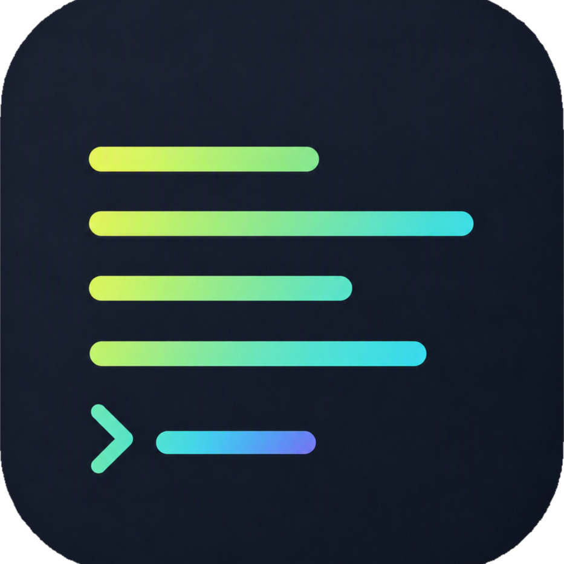
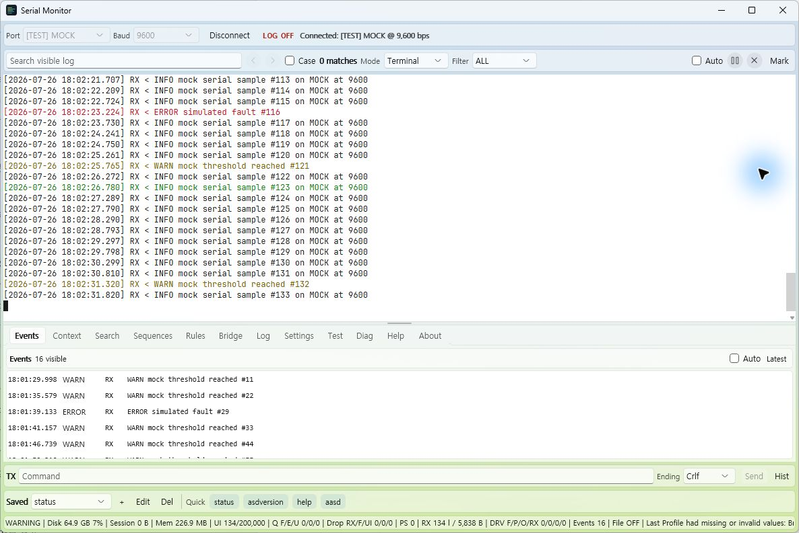

<div align="center">
  
  <h1>Serial Monitor</h1>
  <p>장시간 UART 로그 수집과 반복 검증을 위한 Windows 시리얼 모니터</p>
  <p>
    <a href="https://github.com/Establers/custom-serial-monitor/releases/latest"></a>
    <a href="https://github.com/Establers/custom-serial-monitor/actions/workflows/ci.yml"></a>
    
    <a href="LICENSE"></a>
  </p>
  <p>
    <a href="#다운로드">다운로드</a> ·
    <a href="#ai-plugin-install">AI 플러그인</a> ·
    <a href="docs/release_notes_v1.6.3.md">v1.6.3 변경 사항</a> ·
    <a href="#문서">문서</a>
  </p>
</div>



## 다운로드

| 배포 형식 | 파일 | 실행 방법 |
| --- | --- | --- |
| 설치형 | [SerialMonitorSetup.exe](https://github.com/Establers/custom-serial-monitor/releases/latest/download/SerialMonitorSetup.exe) | 설치 후 시작 메뉴에서 실행 |
| 포터블 | [SerialMonitorPortable.zip](https://github.com/Establers/custom-serial-monitor/releases/latest/download/SerialMonitorPortable.zip) | 전체 압축 해제 후 `SerialMonitor.WinUI.exe` 실행 |

Windows 10/11 **x64**와 Microsoft Edge WebView2 Runtime이 필요합니다.
현재 설치 파일은 코드 서명이 없어 SmartScreen에서 게시자 확인 경고가 표시될 수 있습니다.
배포 파일의 SHA-256 체크섬은 [릴리스 페이지](https://github.com/Establers/custom-serial-monitor/releases/latest)에서 확인할 수 있습니다.

## 주요 기능

| 영역 | 기능 |
| --- | --- |
| 통신 | Terminal·HEX 표시, UTF-8·CP949 등 인코딩, 자동 재연결, 선택적 COM 브리지 |
| 로그 저장 | 비동기 파일 기록, 크기별 파일 회전, 보관 로그 내보내기 |
| 로그 탐색 | 검색·필터·하이라이트, 시간별 위치 이동, 사용자 마커 |
| 이벤트 탐지 | 문자·HEX 규칙, 일치 시점의 전후 문맥 수집, 트레이 알림 |
| 반복 검증 | 저장 명령, 명령 시퀀스, RX Check, 회차별 실행 결과, JSON 공유 |
| AI 연동 | Codex·Claude Code·GitHub Copilot 플러그인, CLI/MCP 제어와 실제 RX 수집 |
| 프로필 | 연결 설정·룰·명령·시퀀스 저장 및 불러오기, 포트별 입력 기록 |

수신·파싱·파일 기록·이벤트 탐지·화면 표시를 분리하고, 화면 로그와 대기 큐의 메모리를 제한합니다.
수신 과부하와 백그라운드 오류는 하단 **Health** 상태에서 확인할 수 있습니다.

## 시작하기

1. **연결** — `Port`와 `Baud`를 선택하고 `Connect`를 누릅니다. 인코딩과 줄 끝은 `Settings`에서 설정합니다.
2. **수신 확인** — `Terminal` 또는 `HEX` 모드에서 장치의 RX/TX를 확인합니다.
3. **기록** — `Log` 탭에서 저장 폴더를 지정하고 `LOG ON`으로 파일 기록을 시작합니다.
4. **검증** — 룰로 이벤트를 탐지하거나, 저장 명령과 시퀀스로 시험 절차를 반복합니다. 설정은 프로필로 저장합니다.

파일 기록을 켜기 전의 데이터도 화면에 보관 중이면 `로그 내보내기...`로 저장할 수 있습니다.
업데이트는 `About`의 `Check for updates`에서 확인합니다.

<a id="ai-skill-install"></a>
<a id="ai-plugin-install"></a>

## AI 플러그인

같은 Windows PC에서 실행 중인 GUI를 Codex·Claude Code·GitHub Copilot으로 제어할 수 있습니다.
플러그인은 공통 스킬과 로컬 MCP 실행기를 제공하며, GUI가 소유한 COM 연결로 명령 전송과 RX 수집을 수행합니다.

앱의 **Plugin** 탭에서 클라이언트별 설치 명령과 연결 테스트를 확인하세요.
프로그램과 플러그인은 각각 업데이트하며, 플러그인 사용에는 프로그램 v1.6.0 이상이 필요합니다.

- [플러그인 설치·업데이트](docs/agent_plugins.md)
- [CLI/MCP 제어 가이드](docs/ai_control.md)
- [기존 단독 스킬 설치](docs/agent_skills.md)

## 사용 범위

- 검색·필터·로그 내보내기는 현재 메모리에 보관된 로그를 대상으로 합니다. 디스크 전체 로그 검색은 외부 도구를 사용합니다.
- GUI의 RX Check 단계는 CLI/MCP 시퀀스에서 지원하지 않습니다.
- 자동 재연결은 같은 COM 포트 이름을 대상으로 하며, 중단된 시퀀스와 브리지는 자동으로 재시작하지 않습니다.
- HEX 파일 로그는 16진수 텍스트로 저장합니다. 원시 `.bin` 기록은 지원하지 않습니다.

자세한 동작과 검증 범위는 [알려진 제한 사항](docs/known_limitations.md)을 참고하세요.

## 개발

Windows x64, .NET 8 SDK, Visual Studio 2022 또는 동등한 MSBuild 환경이 필요합니다.
저장소 루트에서 실행합니다.

```powershell
dotnet build SerialMonitor.WinUI\SerialMonitor.WinUI.sln -c Release
dotnet test SerialMonitor.WinUI\SerialMonitor.WinUI.sln -c Release --no-build -m:1
```

장치 없이 검증하려면 Debug 빌드에서 `Test` 탭의 `Show MOCK test port`를 켜고 `[TEST] MOCK`에 연결합니다.
배포 패키지 생성은 [포터블 배포](docs/portable_deployment.md)와 [설치 파일 배포](docs/installer_deployment.md)를 참고하세요.

## 문서

| 문서 | 내용 |
| --- | --- |
| [시퀀스 작성](docs/sequence_authoring.md) | JSON 규격, AI 요청문, [기본 예제](docs/sequence_examples.json)와 [RX Check 예제](docs/sequence_rx_example.json) |
| [로깅 동작](docs/logging.md) | 파일 기록, 회전, 내보내기와 오류 처리 |
| [아키텍처](docs/architecture.md) | 수신 파이프라인과 백그라운드 처리 구조 |
| [테스트 체크리스트](docs/manual_test_checklist.md) | 기능별 수동 회귀 검사 |
| [장치 테스트](docs/device-test-development-guide.md) | STM32 테스트 펌웨어와 실제 RX 기반 검증 |
| [릴리스 기록](https://github.com/Establers/custom-serial-monitor/releases) | 버전별 변경 사항과 배포 파일 |

## 라이선스

[MIT License](LICENSE). 번들 JetBrains Mono 글꼴은 [SIL Open Font License](SerialMonitor.WinUI/Assets/xterm/fonts/OFL.txt)를 따릅니다.
