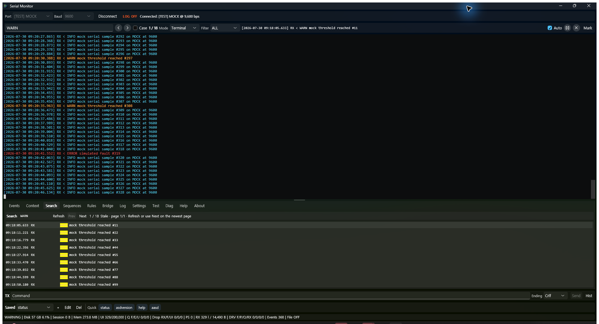

<div align="center">
  
  <h1>Serial Monitor</h1>
  <p><strong>오래 연결해 두어도 버벅이지 않고, 놓친 오류를 다시 찾을 수 있는 Windows 시리얼 모니터</strong></p>
  <p>
    <a href="https://github.com/Establers/custom-serial-monitor/releases/latest"></a>
    
    
    <a href="LICENSE"></a>
  </p>
  <p>
    <a href="https://github.com/Establers/custom-serial-monitor/releases/latest/download/SerialMonitorSetup.exe"><strong>프로그램 다운로드</strong></a>
    ·
    <a href="https://github.com/Establers/custom-serial-monitor/releases/latest/download/SerialMonitorSkills.zip"><strong>스킬 ZIP 다운로드</strong></a>
    ·
    <a href="#ai-skill-install"><strong>AI 스킬 설치</strong></a>
    ·
    <a href="docs/agent_skills.md#share">다른 사람에게 공유</a>
    ·
    <a href="docs/release_notes_v1.5.1.md">v1.5.1 릴리즈 노트</a>
    ·
    <a href="docs/manual_test_checklist.md">테스트 체크리스트</a>
  </p>
</div>

## 다운로드

| 사용 방법 | 다운로드 경로 | 시작 방법 |
| --- | --- | --- |
| 일반 설치 | [프로그램 설치 EXE](https://github.com/Establers/custom-serial-monitor/releases/latest/download/SerialMonitorSetup.exe) | 프로그램 설치 위치 선택 → 설치 후 실행 |
| 프로그램 포터블 | [프로그램 포터블 ZIP](https://github.com/Establers/custom-serial-monitor/releases/latest/download/SerialMonitorPortable.zip) | ZIP 전체를 풀고 `SerialMonitor.WinUI.exe` 실행 |
| AI 스킬만 설치 | [스킬 전용 ZIP](https://github.com/Establers/custom-serial-monitor/releases/latest/download/SerialMonitorSkills.zip) | 스킬 ZIP을 풀고 아래 설치 명령 실행 · [자세한 가이드](docs/agent_skills.md) |

[릴리스 설명과 SHA-256 체크섬](https://github.com/Establers/custom-serial-monitor/releases/latest)도 제공합니다.

<a id="ai-skill-install"></a>

## AI 스킬 빠른 설치

**프로그램이 이미 있다면 스킬 전용 `SerialMonitorSkills.zip`만 받아 설치합니다.**
프로그램은 v1.5.0 이상을 사용하며 설치 폴더에 AI 제어용 `tools\serialctl.exe`가 있어야 합니다.

1. [스킬 ZIP 다운로드](https://github.com/Establers/custom-serial-monitor/releases/latest/download/SerialMonitorSkills.zip)에서
   **`SerialMonitorSkills.zip`**을 받아 압축을 풉니다.
2. 압축을 푼 `SerialMonitorSkills` 폴더에서 PowerShell을 열고 아래 명령을 실행합니다.
   `-CliPath`는 **이미 설치한 프로그램의 CLI 경로**입니다. 아래는 기본 설치 경로이며,
   포터블·사용자 지정 설치라면 자신의 `tools\serialctl.exe` 경로로 바꾸세요.
   예를 들어 D 드라이브에 설치했다면 `-CliPath 'D:\Apps\SerialMonitor\tools\serialctl.exe'`입니다.

```powershell
powershell -NoProfile -ExecutionPolicy Bypass -File .\skills\Install-Skill.ps1 -Client All -Scope User -CliPath "$env:LOCALAPPDATA\Programs\SerialMonitor\tools\serialctl.exe"
```

3. 세 도구의 현재 사용자 범위에 스킬이 설치됩니다. Serial Monitor GUI를 실행하고
   AI 도구에서 스킬을 새로고침하거나 새 세션을 엽니다.
   장치 명령 문서와 함께 다음처럼 요청하세요. `COM7`은 실제 대상 포트로 바꿉니다.

> serial-monitor-control 스킬로 COM7 연결을 확인하고, 제품 문서에 있는 상태 명령을
> 보내서 2초간 받은 전체 RX로 정상 여부를 판단해줘.

CLI 사용에는 MCP 등록이 필요하지 않습니다. MCP를 사용할 때는 앱의 **MCP** 탭 또는
[MCP 안내](skills/serial-monitor-control/references/mcp.md)를 참고하세요.
다른 사람에게도 **스킬 ZIP과 설치 가이드 링크**를 공유하면 됩니다.
특정 도구·프로젝트에만 설치하는 방법은
[스킬 설치·공유 가이드](docs/agent_skills.md#share)에 있습니다.

프로그램 설치 위치는 설치 화면에서 C·D 드라이브 등 원하는 폴더로 고를 수 있습니다.
**스킬은 필요할 때 별도 ZIP으로 수동 설치하며, 프로그램 업데이트가 설치된 스킬을 교체하지 않습니다.**
새 스킬을 적용하거나 프로그램 위치를 옮겼다면 새 ZIP의 설치 명령에 실제 `-CliPath`를 지정해
다시 실행하세요. MCP를 사용한다면 앱의 MCP 탭에서 새 경로로 등록도 수정합니다.
[스킬 업데이트·프로그램 경로 변경 안내](docs/agent_skills.md#app-path)에서 확인하세요.


Serial Monitor는 UART 로그를 몇 분이 아니라 몇 시간, 며칠 동안 관찰하는
임베디드·RTOS 디버깅을 위해 만든 WinUI 3 데스크톱 앱입니다. 화면에는 최근
로그만 제한적으로 유지하고 전체 로그는 별도 작업에서 디스크에 기록합니다.
수신, 파싱, 파일 기록, 이벤트 탐지, UI 표시를 분리해 빠른 데이터가 계속 들어와도
UI 응답성과 메모리 사용량을 예측 가능하게 유지하는 것이 핵심입니다.

## 핵심 사용 흐름

1. COM 포트와 baud rate를 선택해 연결합니다.
2. Terminal 또는 HEX 모드로 RX/TX 데이터를 확인합니다.
3. 필요한 세션은 `LOG ON`으로 전체 기록을 남깁니다.
4. `WARN`, `ERROR`, 재부팅 문자열 같은 규칙을 등록해 이벤트와 전후 문맥을
   자동으로 모읍니다.
5. 검색 결과, 사용자 마커, 하단 상태 카운터로 문제가 발생한 시점을 좁힙니다.
6. 저장 명령과 시퀀스로 같은 재현 절차를 반복합니다.

## 왜 장시간 디버깅에 적합한가요?

- **화면 메모리가 계속 자라지 않습니다.** UI 로그와 이벤트는 bounded buffer로
  제한하고, 전체 기록은 일반 텍스트 파일에 비동기로 저장합니다.
- **수신 경로에서 UI나 디스크를 기다리지 않습니다.** background channel과
  queue가 컴포넌트를 분리하며, 과부하는 drop/error 카운터로 드러납니다.
- **오류 한 줄만 남기지 않습니다.** 키워드 규칙이 일치한 시점의 앞뒤 문맥까지
  함께 캡처해 재현 전후 상태를 확인할 수 있습니다.
- **백그라운드 실패를 숨기지 않습니다.** 파일, 파이프라인, bridge 오류와 큐
  상태를 하단 Health 표시와 원인 툴팁에서 확인하고 우클릭으로 복사할 수 있습니다.
- **반복 작업을 프로필로 재사용합니다.** 포트 설정, 룰, 하이라이트, 저장 명령,
  명령 시퀀스를 JSON 프로필로 저장하고 다시 불러올 수 있습니다.

## 5분 안에 시작하기

### 1. 설치

[Releases](https://github.com/Establers/custom-serial-monitor/releases/latest)에서
다음 중 하나를 받습니다.

- `SerialMonitorSetup.exe`: 일반 설치 버전
- `SerialMonitorPortable.zip`: 설치와 관리자 권한이 필요 없는 포터블 버전

포터블 버전은 ZIP 전체를 푼 뒤 `SerialMonitor.WinUI.exe`를 실행하세요. EXE만
따로 옮기거나 ZIP 안에서 바로 실행하면 안 됩니다.

> Windows 10/11 x64용입니다. xterm 로그 화면에는 Microsoft Edge WebView2
> Runtime이 필요합니다. 설치 파일은 현재 코드 서명이 없어 SmartScreen에서
> 알 수 없는 게시자 경고가 표시될 수 있습니다.

### 2. 장치 연결

먼저 `Port` 왼쪽의 `Terminal`/`HEX` 모드를 확인한 뒤 `Port`와 `Baud`를 선택하고
`Connect`를 누릅니다. 모드 드롭다운의 각 항목에 간단한 설명이 표시됩니다. 데이터 형식과 줄 끝,
encoding, Terminal/HEX 모드는 `Settings`에서 조정할 수 있습니다.

### 3. 장치 없이 둘러보기

Debug 빌드에서는 `Test` 탭의 `Show MOCK test port`를 켠 뒤 `[TEST] MOCK`에
연결할 수 있습니다. 일반 로그, WARN/ERROR 주입, burst와 stress 동작을 실제
파이프라인으로 확인할 때 사용합니다. 배포용 Release 빌드에서는 MOCK 포트가
표시되지 않습니다.

### 4. 전체 로그 저장

`Log` 탭에서 저장 폴더, 파일 이름, 회전 크기를 정한 뒤 `LOG ON`을 누릅니다.
HEX 모드의 수신 데이터는 byte-exact 16진수 텍스트로 기록되며 raw `.bin` 기록은
제공하지 않습니다.

## 주요 기능

`About`에서 설치 버전과 업데이트 상태를 함께 확인할 수 있습니다.
`Check for updates`를 눌렀을 때만 새 버전을 확인합니다. 새 정식 버전이 있으면 하단 상태줄
오른쪽에 작은 `Update v…` 버튼이 표시됩니다. 클릭하면 About으로 이동하며, 로그 위에
팝업을 띄우거나 작업 화면을 자동 전환하지 않습니다. `View release`로 변경 사항과
다운로드 페이지를 열 수 있고, 옆의 `…` 메뉴에서 해당 버전 알림을 건너뛸 수 있습니다.
수동 확인하면 알림을 건너뛴 버전도 이번 실행에서 다시 표시됩니다.
자동 설치나 재시작은 하지 않습니다. 마지막 확인 결과는 재실행 후에도 유지되며,
설정은 프로필과 별도로 `%LOCALAPPDATA%\SerialMonitor\updates.json`에 저장됩니다.
GitHub API 요청 한도를 초과하면 GitHub Pages의
[`updates.json`](https://establers.github.io/custom-serial-monitor/updates.json)으로 대체 확인합니다.
API와 대체 요청의 네트워크 대기는 합계 최대 10초이며, 일반 접속 오류에는 대체 요청을 하지 않습니다.
안내 파일은 정식 릴리스 게시 후 자동 갱신됩니다. 자세한 배포 절차는
[업데이트 확인 문서](docs/update_ui_testing.md#static-fallback-manifest)를 참고하세요.
개발 중에는 [업데이트 UI 미리보기](docs/update_ui_testing.md)로 새 버전·최신·오프라인·확인 중 상태를 검증할 수 있습니다.

| 영역 | 제공 기능 |
| --- | --- |
| RX 표시 | 실제 COM 포트, Terminal/HEX 모드, UTF 계열·코드 페이지 디코딩, timestamp와 RX/TX prefix |
| 연결 복구 | 실제 COM의 예기치 않은 읽기/쓰기 실패 후 같은 포트 자동 재연결, 1·2·5·10초 backoff, 수동 취소 |
| 대용량 화면 | xterm.js 기반 선택·복사, 선택 구간 시간차 및 HEX byte 길이 툴팁, batched append, bounded UI log buffer, pause/auto-scroll |
| 파일 기록 | 비동기 plain-text 기록, 크기 기반 회전, 사용자 파일 이름, flush/error 카운터 |
| 이벤트 | Terminal/HEX 전용 규칙, 전후 문맥, 일치 문자열 강조, 트레이 알림 |
| 검색 | 현재 보관 중인 로그 검색, F3/Shift+F3/F4, 결과 목록, 1,000줄 단위 페이지 |
| TX | 수동 전송, 줄 끝 설정, 저장 명령, quick button, 명령 history, 사용자 marker |
| 자동화 | 명령 시퀀스·1~9,999회 반복, 개별 JSON 공유·다중 불러오기, TX 진행 상태, RX 룰 기반 안전한 1회 트리거 |
| 프로필 | 설정·룰·명령·시퀀스 JSON 저장/불러오기/초기화, 이전 형식 정규화 |
| Bridge | 물리 COM과 가상 COM 사이의 선택적 양방향 raw-byte 전달 및 상태 확인 |
| 상태/장애 확인 | 하단 큐/drop/error 카운터, Health 원인 툴팁, 우클릭 상태 복사, 런타임 오류 파일 |

## 검색과 이벤트 검토



상단 검색은 현재 화면 메모리에 보관된 로그 snapshot을 대상으로 합니다. 결과는
시간, 방향, 메시지로 나뉘며 행을 더블 클릭하면 원본 로그 위치로 이동합니다.
같은 줄의 반복 일치는 한 행으로 묶고, 일치 로그가 많으면 1,000줄 단위로
페이지를 이동합니다. VS Code와 같은 `Aa`(대/소문자 구분), `|ab|`(단어 단위),
`.*`(정규식) 옵션을 조합할 수 있으며 검색창에서 `Alt+C`, `Alt+W`, `Alt+R`로
각 옵션을 전환할 수 있습니다.

로그가 계속 들어오는 동안 선택이 흔들리지 않도록 결과 목록은 수동 새로고침이
기본입니다. 새 로그를 포함하려면 `Enter`, `Refresh`, 또는 최신 페이지의 `Next`를
사용하세요. 검색어 또는 검색 옵션을 편집하는 동안에는 이전 결과를 `Stale` 상태로
유지하며, `Enter`나 `Refresh`를 실행할 때 새 결과로 교체합니다. 디스크에 기록된
전체 로그 검색은 현재 외부 텍스트 도구가 필요합니다.

`F3`는 다음 일치로, `Shift+F3` 또는 `F4`는 이전 일치로 이동합니다.

## AI CLI / MCP 제어

실행 중인 GUI의 연결을 Codex·Claude Code·GitHub Copilot CLI에서 사용할 수 있습니다.
`tools\serialctl.exe`로 포트 연결, Terminal/HEX 모드 조회·변경, 명령 전송, 시퀀스 등록·실행·중지, 지정 시간의 **전체 RX 수집**과 페이지 조회를
수행합니다. 제품에서 섞여 나온 printf 출력도 원문으로 AI에 전달합니다. GUI 하단에서
작업 상태를 확인하고 `AI 중지`로 수집을 끝낼 수 있습니다.
설정과 사용 예는 [AI 제어 가이드](docs/ai_control.md)를 참고하세요.

시퀀스는 `serialctl sequence save --file check.json`으로 GUI 목록과 프로필에 저장하고,
`serialctl sequence run --name "장치 확인"`으로 실행합니다. 실행 ID를 받은 뒤
`sequence status --run ID`와 `sequence cancel --run ID`로 확인·중지할 수 있습니다.
실행 시작이 승인되면 CLI를 닫아도 계속 실행되며, GUI의 `AI 중지`와 시퀀스 Stop도 사용할 수 있습니다.
등록 자체는 전송하지 않고, 기존 이름을 바꾸려면 `--overwrite true`를 명시해야 합니다.

선택적인 예상 응답은 연속된 문자열 또는 HEX 바이트의 정확한 포함 여부만 확인합니다.
`abcd`가 `ab12c3d4`로 섞여 들어오면 `not_matched`이며 제품 실패로 단정하지 않습니다.
매칭과 무관하게 정해진 시간의 전체 RX를 저장하므로, 반환된 `captureId`로 원문을 읽어 판단할 수 있습니다.
시퀀스는 단계별로 한 번만 전송하며 미매칭·전송 오류 시 자동 재전송하지 않습니다.

Codex·Claude Code·GitHub Copilot에서 같은 절차를 재사용할 수 있는
[CLI 제어 스킬](skills/serial-monitor-control/SKILL.md)도 제공합니다. CLI를 기본으로 사용하고
로컬 MCP는 선택적으로 활용합니다. [스킬 설치 가이드](docs/agent_skills.md)의 설치 스크립트로
프로젝트 또는 사용자 범위에 설치할 수 있으며, **별도 다운로드인 `SerialMonitorSkills.zip`**에
설치 스크립트·스킬·안내문이 모두 포함됩니다.

앱의 **MCP** 탭에서 빠른 시작, Claude Code / Codex / GitHub Copilot의 CLI와
VS Code 확장별 등록 방법, 복사 가능한 설정·프롬프트, 수집 한도와 오류 해결을 확인할 수 있습니다.
`serialctl.exe` 경로를 바꾸면 각 클라이언트의 명령과 설정 예제가 함께 갱신됩니다.

## 안정성을 위한 구조

```text
Serial RX
  -> bounded byte channel
  -> framing / decoding / timestamp
  -> bounded LogLine channel
       -> batched, bounded UI renderer
       -> asynchronous file writer
       -> event detector + context capture
```

serial receive callback은 UI control을 갱신하거나 파일을 쓰지 않습니다. 각
background worker는 cancellation을 지원하고, 비정상 종료를 잡아 UI에 노출합니다.
종료 시에는 producer를 먼저 멈추고 writer가 제한된 시간 안에 drain·flush하도록
정리합니다. 자세한 설계는 [아키텍처 문서](docs/architecture.md)를 참고하세요.

## 알아둘 제한 사항

- 화면 검색은 디스크 전체가 아니라 현재 retained UI buffer만 대상으로 합니다.
- 이벤트 탐지는 keyword/rule 기반이며 Terminal 룰과 HEX 룰은 서로 다른 모드에서
  동작합니다.
- command sequence는 고정 명령과 지연을 순서대로 실행합니다. 응답 분기와
  parameter template은 아직 제공하지 않습니다.
- 자동 재연결은 같은 COM 포트 이름을 다시 엽니다. 장치 고유 ID를 따라 COM
  번호 변경을 추적하지 않으며, 중단된 bridge나 command sequence를 자동으로
  다시 시작하지 않습니다.
- COM bridge는 byte를 그대로 전달하지만 modem-control line과 BREAK를 전달하지
  않으며, com0com 같은 가상 포트 드라이버는 별도로 준비해야 합니다.
- bridge의 장치 → 가상 포트 방향은 실제 COM에서 **수신한 RX**를 전달합니다.
  앱에서 실제 COM으로 보낸 TX 자체는 복사하지 않으며, 장치가 보낸 응답/echo는
  RX로 들어오므로 전달됩니다. 같은 COM 포트를 여러 프로그램이 동시에 열 수는
  없으며, 외부 프로그램은 앱이 연 가상 포트의 반대쪽 포트를 열어야 합니다.
- MOCK/stress 검증은 실제 USB-UART adapter와 장치의 장시간 검증을 대체하지
  않습니다.

전체 목록은 [Known Limitations](docs/known_limitations.md)에서 관리합니다.

## 개발 및 빌드

요구 사항은 Windows 10/11 x64, .NET 8 SDK, Visual Studio 2022 또는 동등한
MSBuild 환경입니다.

```powershell
dotnet build SerialMonitor.WinUI\SerialMonitor.WinUI.sln -c Debug
dotnet build SerialMonitor.WinUI\SerialMonitor.WinUI.sln -c Release
dotnet test SerialMonitor.WinUI\SerialMonitor.WinUI.sln -c Debug
```

포터블 ZIP과 선택적 Inno Setup 설치 파일은 저장소 루트에서 만듭니다.

```powershell
powershell -ExecutionPolicy Bypass -File scripts\publish_portable.ps1
powershell -ExecutionPolicy Bypass -File scripts\build_installer.ps1
```

출력은 `release` 폴더에 생성되며 MSIX/AppX 패키지는 사용하지 않습니다.
자세한 절차는 [포터블 배포](docs/portable_deployment.md)와
[설치 파일 배포](docs/installer_deployment.md)를 참고하세요.

## 데이터 위치

| 데이터 | 기본 위치 |
| --- | --- |
| 시리얼 로그 | `%LOCALAPPDATA%\SerialMonitor\logs` |
| 기본 프로필 | `%LOCALAPPDATA%\SerialMonitor\profiles\default.json` |
| 마지막 런타임 오류 | `%LOCALAPPDATA%\SerialMonitor\diagnostics\instance-<pid>-<launch-id>\last_runtime_error.txt` |

실행마다 별도의 `instance-*` 진단 폴더를 만듭니다. 해당 폴더의
`last_startup.txt`에 기록된 시작 시각으로 확인하려는 실행을 구분하세요.
`last_runtime_error.txt`는 오류가 발생했을 때만 생성됩니다.
`diagnostics` 바로 아래에 남은 `.txt` 파일은 이전 버전 기록이며 현재 실행에서 갱신하지 않습니다.

## 문서

- [AI용 시퀀스 JSON 작성 가이드](docs/sequence_authoring.md): 복사할 AI 요청문,
  실제 필드 규격, 시퀀스 JSON 불러오기·내보내기 방법. [JSON 예제](docs/sequence_examples.json)와
  함께 빌드·배포 결과의 실행 파일 옆 `docs` 폴더에 포함됩니다.
- [요구 사항](docs/requirements.md)
- [아키텍처](docs/architecture.md)
- [로깅 동작](docs/logging.md)
- [수동 회귀 테스트](docs/manual_test_checklist.md)
- [com0com 스트레스 테스트](docs/com0com_stress_testing.md)
- [HEX RX 버스 사용량 계산](docs/bus_utilization.md)
- [v1.5.1 릴리즈 노트](docs/release_notes_v1.5.1.md)
- [v1.5.0 릴리즈 노트](docs/release_notes_v1.5.0.md)
- [v1.4.2 릴리즈 노트](docs/release_notes_v1.4.2.md)
- [v1.4.1 릴리즈 노트](docs/release_notes_v1.4.1.md)
- [v1.4.0 릴리즈 노트](docs/release_notes_v1.4.0.md)
- [v1.3.8 릴리즈 노트](docs/release_notes_v1.3.8.md)
- [v1.3.7 릴리즈 노트](docs/release_notes_v1.3.7.md)
- [v1.3.6 릴리즈 노트](docs/release_notes_v1.3.6.md)
- [v1.3.5 릴리즈 노트](docs/release_notes_v1.3.5.md)
- [v1.3.3 릴리즈 노트](docs/release_notes_v1.3.3.md)
- [v1.3.2 릴리즈 노트](docs/release_notes_v1.3.2.md)
- [v1.3.1 릴리즈 노트](docs/release_notes_v1.3.1.md)
- [v1.3.0 릴리즈 노트](docs/release_notes_v1.3.0.md)
- [v1.2.5 릴리즈 노트](docs/release_notes_v1.2.5.md)

## 라이선스

[MIT License](LICENSE)로 배포됩니다. 포함된 JetBrains Mono 글꼴은
`SerialMonitor.WinUI/Assets/xterm/fonts/OFL.txt`의 SIL Open Font License를
따릅니다.
